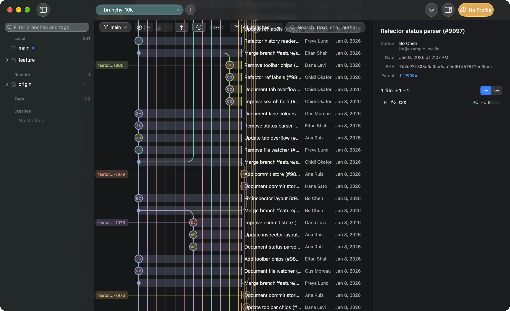

# Jit

A premium, ultra-lightweight native macOS Git client — 100% Swift (SwiftUI + AppKit), native Liquid
Glass design, driving the Git CLI. No Electron, web views, background daemons or telemetry.



## Status

**V1 (Phases 0–7) is implemented and merged to `main`. The current version is 0.0.1, a local test build
([notes](docs/releases/v0.0.1.md)); the public 1.0.0 is not yet published.**

| Phase | State | Report |
|---|---|---|
| 0 Foundation & design | done | [progress](docs/phases/00-foundation/progress.md) |
| 1 Native shell & repository tabs | done | [progress](docs/phases/01-shell-and-tabs/progress.md) |
| 2 Git graph & navigation | done | [progress](docs/phases/02-graph-and-navigation/progress.md) |
| 3 Working directory & diff | done | [progress](docs/phases/03-working-directory-and-diff/progress.md) |
| 4 Git workflows & conflicts | done | [progress](docs/phases/04-git-workflows-and-conflicts/progress.md) |
| 5 Profiles & providers | done | [progress](docs/phases/05-profiles-and-providers/progress.md) |
| 6 Polish & performance | done, with carry-overs | [progress](docs/phases/06-polish-and-performance/progress.md) |
| 7 Packaging & release | done, with carry-overs | [progress](docs/phases/07-packaging-and-release/progress.md) |
| 8 Post-V1 epics | planned, not started | [design](docs/phases/08-post-v1/design.md) |

Builds are **ad-hoc signed and not notarized** (owner decision 2026-11-10: free distribution, no paid
Apple Developer Program; ADR-0049). Developer ID signing and notarization are scripted but have never been run.
Last full local run: 745 core tests passed, 0 failed; app tests and lint clean.

## What Jit does (V1)
- **Repository tabs** — one window, tabs restored on relaunch (only the active tab loads), new-tab page with
  recents, live status from FSEvents while visible, no polling.
- **Commit graph** — virtualized graph for large histories, branch navigator, commit details, search and
  filter, file history, compare two commits.
- **Working directory & diff** — native unified/split diff with syntax highlighting and word diff;
  stage, unstage and discard by file, hunk or line; blame; commit and amend with the profile's identity.
- **Everyday workflows** — fetch, pull (fast-forward only by default), push (force-with-lease only, never plain
  `--force`), clone, branch create/switch/rename/delete/upstream, merge, rebase, cherry-pick, revert with
  continue/skip/abort, stash, activity history.
- **Conflicts** — three-way resolver with explicit ours/theirs labels and non-text fallbacks.
- **Profiles & providers** — global profiles applied per invocation (never touches `~/.gitconfig` or
  `~/.ssh/config`); SSH, PAT and OAuth with secrets only in the Keychain; GitHub and GitLab including
  self-managed, custom CA and proxy; remote repository browser; connectivity diagnostics.
- **Polish** — ⌘K command palette, accessibility (VoiceOver rotors, Reduce Motion, differentiate without
  color), memory-pressure trimming and tab suspension.
- **Packaging** — bundled, relocatable Git 2.56.0; Settings ▸ Git to choose another (2.39+).

Not in V1 by design: pull/merge request management, code review, CI dashboards, AI assistant.

## What remains
**To publish 1.0.0**
- Set `MARKETING_VERSION` back to 1.0.0 in `macos/App/Config/Version.xcconfig` (it is 0.0.1 for testing).
- The GitHub repository is private, and there is no `v1.0.0` tag or GitHub Release yet. Notes are in
  [`docs/releases/v1.0.0.md`](docs/releases/v1.0.0.md); assets are produced into `build/release/1.0.0/publish/`.
- The existing 1.0.0 DMG was built from `d3bd9b8`; `main` has moved on since (CI fixes, MIT license). Rebuild with
  `scripts/release/release.sh --version 1.0.0 --adhoc` before publishing so the artifact and its SHA-256 match the
  tagged commit.
- CI on `main` is not green: the last run did not start (GitHub Actions billing/spending limit), and the run
  before it failed the advisory performance gate. The gate was relaxed afterwards but that change is unverified in CI.

**Never verified**
- Developer ID signing, notarization, stapling and Gatekeeper acceptance (no certificate).
- Clean-machine acceptance on a fresh macOS 26 VM without developer tools (ADR-0048).
- OAuth sign-in against real providers — no OAuth clients are registered, so OAuth shows "not configured"
  (PAT and SSH work). Real GitHub/GitLab accounts were not used; only the local enterprise rig.
- Live VoiceOver walkthrough, Instruments animation-hitch and Metal traces, and a by-eye review of settings,
  repository browser, resolver and clone sheet under Reduce Transparency / Increase Contrast.

**Known gaps**
- No XCUITest target (keyboard-only commit and conflict flows, accessibility audit are untested at UI level).
- Tab switch is 17.4 ms median against a 16 ms target.
- In a short window with a diff open, the inspector gives the file list too little height.
- No auto-updater (by design, ADR-0020): updating means replacing the app.

**Post-V1 (Phase 8, all unstarted)** — reflog explorer, reset, tags, interactive rebase, commit surgery,
history filters, worktrees, patches, advanced remotes, branch history manipulation, signing, submodules, LFS.

## Install
- **System requirements:** macOS 26 or later on Apple silicon (arm64; ADR-0049). Nothing else: Jit bundles Git
  2.56.0 and doesn't need Xcode, the Command Line Tools or Homebrew. SSH uses the system `/usr/bin/ssh`.
- **Get the app:** there is no public download yet (see [What remains](#what-remains)). Build the DMG yourself
  with `scripts/release/release.sh --adhoc` (see [`docs/release.md`](docs/release.md)), open
  `build/release/0.0.1/Jit-0.0.1.dmg` and drag **Jit** to **Applications**. A DMG built on your own Mac is not
  quarantined and opens without the step below.
- **First launch — Jit is not notarized by Apple** (it's signed ad-hoc). A DMG downloaded from the internet
  makes macOS show "“Jit” Not Opened — Apple could not verify…". Click **Done** (not Move to Trash), then either:
  - **System Settings → Privacy & Security**, scroll to "“Jit” was blocked…", click **Open Anyway**, confirm
    with your password, then click **Open**; or
  - in Terminal: `xattr -dr com.apple.quarantine /Applications/Jit.app`, then open Jit normally.

  You do this once per downloaded version. Check the DMG's SHA-256 against the release notes first:
  `shasum -a 256 ~/Downloads/Jit-<version>.dmg`.
- **Updating**: replace the app with the new version and repeat the first-launch step. Because ad-hoc builds
  have no stable signing identity, macOS may ask once whether the new Jit may use the Keychain items it saved
  (tokens, SSH passphrases); choose **Always Allow**.
- What's included: Jit, `jit-git-helper` (credential helper), and Git 2.56.0 under the GNU GPL v2. The license,
  the source location and a written offer are in **Help ▸ Acknowledgements**. Jit makes no network requests on
  its own.

## Develop

Prerequisites:
- macOS 26+ with **full Xcode 26+** selected (`xcode-select -p` must point into `Xcode.app`).
- XcodeGen (`brew install xcodegen`).
- Git 2.39+ for development builds (Homebrew or the Xcode Command Line Tools); release builds bundle Git.

No Rust toolchain or third-party Swift packages are needed (ADR-0002).

```bash
scripts/build/build-all.sh debug --test   # generate project, build Jit.app, run all tests
open ~/Library/Developer/Xcode/DerivedData/Jit/Build/Products/Debug/Jit.app
```
Open the project in Xcode with `scripts/build/gen-xcodeproj.sh && open macos/Jit.xcodeproj`.

| Task | Command |
|---|---|
| Core tests | `scripts/build/test-core.sh` |
| App/UI tests | `scripts/build/test-app.sh` |
| Lint (format + architecture rules) | `scripts/build/lint.sh` |
| Benchmarks | `scripts/benchmarks/run-all.sh [--quick]` |
| Bundled Git | `scripts/build/build-git.sh`, `scripts/build/test-bundled-git.sh` |
| Release DMG | `scripts/release/release.sh [--adhoc]` |

All commands, debug launch arguments and test rigs: [`CLAUDE.md`](CLAUDE.md#commands) and
[`docs/testing.md`](docs/testing.md).

## Layout
```
macos/App/                 thin app target (AppKit entry point, menus, launch/benchmark hooks)
macos/Packages/JitKit/     GitCore, GitTestKit, Services, DesignSystem, Features, JitBench + tests
macos/project.yml          XcodeGen spec (project is generated, not committed)
scripts/build/             build, test, lint, bundled-Git build scripts
scripts/release/           release steps 01–09 + release.sh (sign, DMG, notarize, validate)
scripts/benchmarks/        launch, idle and scenario benchmarks
scripts/testing/           screenshots, local enterprise test rig
benchmarks/                benchmark baselines and results
docs/                      product, architecture, design system, performance, security, release, ADRs, phases
```

## Documentation
- [`docs/master-prompt.md`](docs/master-prompt.md) — requirements; [`docs/roadmap.md`](docs/roadmap.md) — plan.
- [`docs/architecture.md`](docs/architecture.md), [`docs/design-system.md`](docs/design-system.md),
  [`docs/performance.md`](docs/performance.md), [`docs/security.md`](docs/security.md),
  [`docs/testing.md`](docs/testing.md), [`docs/release.md`](docs/release.md),
  [`docs/product.md`](docs/product.md), [`docs/adr/`](docs/adr/) (49 decisions).
- [`docs/phases/`](docs/phases/) — one folder per phase (design, implementation plan, kickoff prompt, progress).

## License
Jit is released under the [MIT License](LICENSE). The Git it bundles is licensed separately under the GNU GPL v2
(Help ▸ Acknowledgements).
