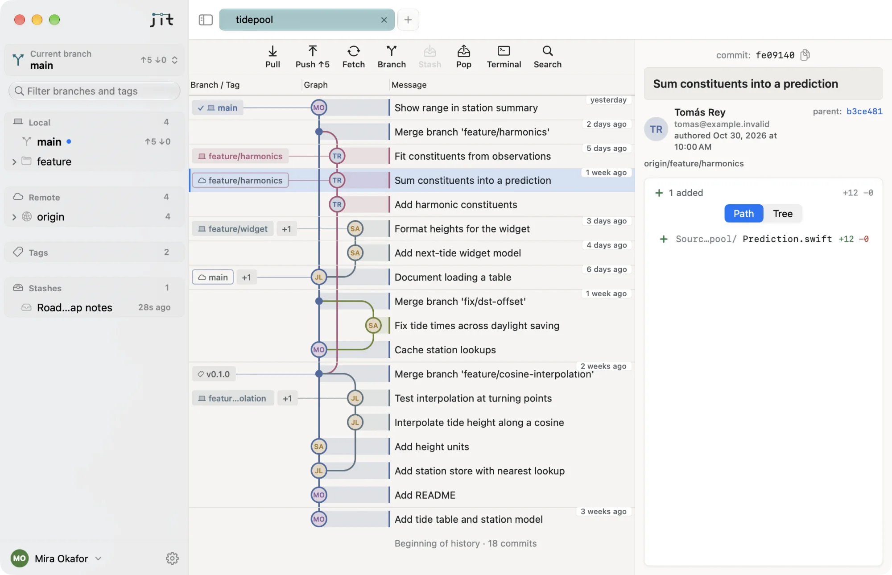
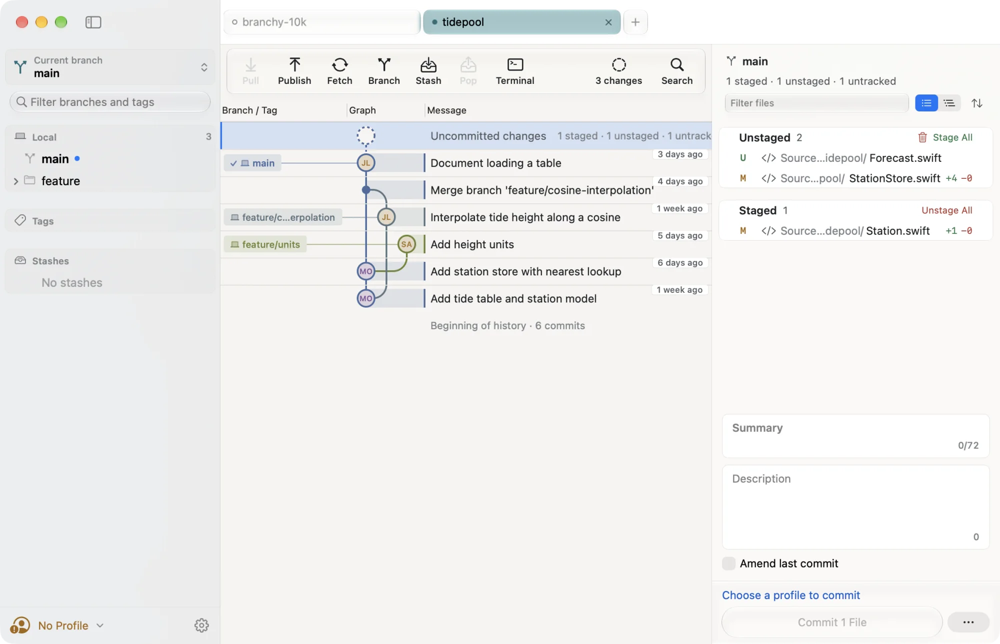
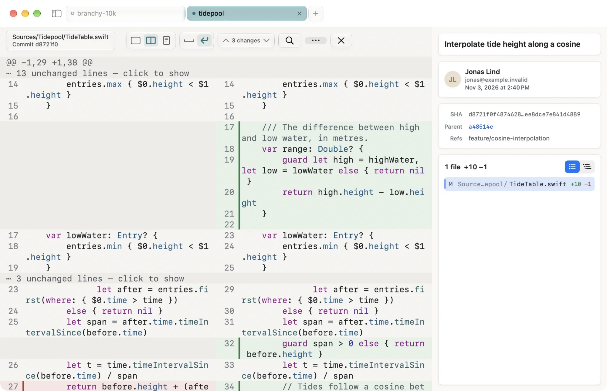

<h1>
  <picture>
    <source media="(prefers-color-scheme: dark)" srcset="docs/assets/logotype-dark.svg">
    
  </picture>
</h1>

A free, lightweight Git app for Mac. See your project’s history, review changes, and manage branches
in a clear, native macOS interface.

**[Download Jit](https://github.com/ashkanRmk/jit/releases)** · **[Website](https://ashkanrmk.github.io/jit/)**

Requires **macOS 26 or later** and a Mac with **Apple silicon (M1 or newer)**.
Jit is currently available as an early test build.

<picture>
  <source media="(prefers-color-scheme: dark)" srcset="site/assets/shots/graph-dark.webp">
  
</picture>

| Working copy | Side-by-side diff |
|---|---|
| <picture><source media="(prefers-color-scheme: dark)" srcset="site/assets/shots/wip-dark.webp"></picture> | <picture><source media="(prefers-color-scheme: dark)" srcset="site/assets/shots/diff-dark.webp"></picture> |

## Why choose Jit?

- **Built for Mac.** A native app with familiar controls, light and dark themes, and an adjustable workspace.
- **Lightweight.** A download of about 11 MB, with Git included and no extra tools to install.
- **Free and open source.** No subscription, paid tier, or Jit account required.
- **Private.** No telemetry or analytics. Your repositories stay on your Mac and the Git services you use.

Jit focuses on working with Git: commits, branches, changes, and recovery. Pull-request reviews and
CI dashboards remain on your Git hosting service.

## Main features

- **Understand your history.** Explore a visual commit graph, search commits, view file history, and
  compare changes.
- **Review and commit changes.** Read side-by-side diffs and choose exactly which files or lines to
  include in a commit.
- **Manage branches and sync.** Clone repositories, fetch, pull, push, merge, rebase, stash changes,
  and clean up old branches.
- **Resolve conflicts and recover work.** Use a visual conflict resolver, find lost commits, and
  review resets before applying them.
- **Keep projects and accounts organized.** Open repositories in tabs, manage tags, and switch between
  work and personal profiles. Connect to GitHub and GitLab using SSH keys or personal access tokens.

## Download and install

1. Open [GitHub Releases](https://github.com/ashkanRmk/jit/releases) and choose the newest test build.
2. Under **Assets**, download the file named **Jit-&lt;version&gt;.dmg**.
3. Open the downloaded file and drag **Jit** into **Applications**.
4. Open **Jit** from Applications, then open an existing repository or clone one to get started.

**If macOS blocks the first launch:** Jit is not yet notarized by Apple. Click **Done** on the warning,
then go to **System Settings → Privacy & Security → Open Anyway** and confirm that you want to open Jit.

### Updating

Open the bell icon in Jit to read **What's New**. The changelog refreshes when its cached notes are
missing or a day old. To check immediately, choose **Check for Updates**. When an update is available,
choose **Install and Restart**. You can enable automatic updates in **Settings → General**.

To upgrade from **0.1.2 or earlier**, install **0.1.3 or newer** from the release DMG.
Jit verifies the release signature and the disk image before installing future updates. See the
[release guide](docs/release.md#publishing-owner-approval-required) for verifying the manual download.

## License

Jit is free and open source under the [MIT License](LICENSE).
Bundled Git is licensed separately under the GNU GPL v2; see **Help → Acknowledgements** in the app.
