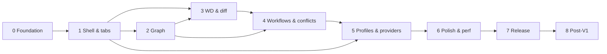

# Jit — Implementation Roadmap

> Status: **planning**. Nothing described here is implemented yet. Each phase folder under
> [`docs/phases/`](phases/) holds a design doc, an implementation plan and a kickoff prompt.
> The source requirements are in [`docs/master-prompt.md`](master-prompt.md); section references
> such as **§7.4** point into that file.

Jit is a native macOS Git client: SwiftUI + AppKit UI, a Rust Git core behind UniFFI, the installed
(later bundled) Git CLI underneath. Premium visual quality and near-zero idle cost are release
requirements, not polish (§2, §3, §15).

---

## 1. How to use these documents

1. Run phases in order. A phase starts only when the previous phase's `progress.md` shows its
   exit gate passed (or lists accepted carry-overs).
2. Open a fresh Claude Code session at the repository root, paste the phase's `prompt.md`
   block, and let it work through the milestones in `implementation.md`.
3. The agent writes `progress.md` in the phase folder at the end (template in
   [`phases/README.md`](phases/README.md)). That file — not the plan — is the record of what is real.
4. If reality diverges from a plan (an API doesn't exist, a spike picks the other option), the agent
   updates the phase docs and records an ADR. Plans are living documents; the master prompt is not.

## 2. Environment snapshot (2026-11-08)

Captured on the planning machine. Phase 0 re-verifies all of it.

| Item | Found | Consequence |
|---|---|---|
| macOS | 27.2 (build 26B123), arm64 | Deployment target stays macOS 14 (§1); test on 14 later via VM. |
| Xcode | **Not installed** — only Command Line Tools are active | **Blocker for Phase 0.** App bundles, XCTest UI tests, Instruments, asset catalogs and signing need full Xcode. Install Xcode and run `sudo xcode-select -s /Applications/Xcode.app`. |
| Swift | 6.3.3 (CLT) | Swift 6 language mode with strict concurrency. |
| Rust | rustc / cargo 1.89.0 | Update with `rustup update stable` and pin in `rust-toolchain.toml`. Add `x86_64-apple-darwin` target in Phase 7. |
| Git | 2.54.0 | Development Git. Minimum supported Git version is decided in ADR-0006. |
| Repository | Empty; remote `https://github.com/ashkanRmk/jit` has no commits | Phase 0 creates the scaffold. |
| Signing | Unknown | Developer ID + notarization credentials are only needed in Phase 7. |

## 3. Phase map

| # | Phase | Folder | Demo at the end of the phase | Relative size |
|---|---|---|---|---|
| 0 | Foundation & design | [`00-foundation`](phases/00-foundation/) | App window opens, picks a folder, Rust reports repository info; token gallery in light/dark; baseline numbers recorded. | M |
| 1 | Native shell & repository tabs | [`01-shell-and-tabs`](phases/01-shell-and-tabs/) | Multiple repo tabs restored on relaunch, new-tab page, themes, identity-only profiles + indicator, live status via FSEvents, menus. Idle CPU ≈ 0. | M |
| 2 | Git graph & navigation | [`02-graph-and-navigation`](phases/02-graph-and-navigation/) | Beautiful virtualized graph over a 100k-commit repo at 60 FPS, branch navigator, commit details, search/filter, file history, compare lists. | L |
| 3 | Working directory & diff | [`03-working-directory-and-diff`](phases/03-working-directory-and-diff/) | Native diff (unified/split), syntax highlighting, file/hunk/line stage-unstage-discard proven safe by tests, blame, commit & amend with profile identity. | XL |
| 4 | Everyday workflows & conflicts | [`04-git-workflows-and-conflicts`](phases/04-git-workflows-and-conflicts/) | Fetch/pull/push/clone (no stored credentials yet), branch ops, merge/rebase/cherry-pick/revert, three-way conflict resolver, continue/abort. | XL |
| 5 | Profiles & providers | [`05-profiles-and-providers`](phases/05-profiles-and-providers/) | Global profiles with SSH/PAT/OAuth, Keychain, GitHub/GitLab/self-managed browsing & clone, custom CA, proxy, mismatch handling. | XL |
| 6 | Polish & performance | [`06-polish-and-performance`](phases/06-polish-and-performance/) | Profiled and optimized build hitting (or honestly reporting against) §15.1 targets; a11y, keyboard, command palette, visual regression suite. | L |
| 7 | Packaging & release | [`07-packaging-and-release`](phases/07-packaging-and-release/) | Universal, signed, notarized, stapled DMG with bundled Git, verified on a clean macOS VM against scenarios A–G (§24). | M |
| 8 | Post-V1 roadmap | [`08-post-v1`](phases/08-post-v1/) | Epics for interactive rebase, stash, worktrees, reflog, reset, tags, patches, LFS, submodules… | — |

### Scope adjustments versus the master prompt's phase list (§22)

These moves keep each phase a working vertical slice. They do not drop any requirement.

- **Identity-only profiles move up to Phase 1.** Phase 3 needs an active profile to commit (§6.2).
  Phase 1 ships the profile model, a minimal create/edit sheet (name, display name, author name/email)
  and the global indicator/switcher. Phase 5 adds authentication, providers and networking to the same model.
- **File history moves to Phase 2** — it is a path-filtered history view and reuses the graph.
- **Blame lands in Phase 3** — it needs the native code renderer built there.
- **Checkout and all other branch mutations live in Phase 4** with the operation/confirmation framework.
  Phase 2's navigator is read-only plus copy actions.
- **Clone from URL lands in Phase 4** (public HTTPS / agent-based SSH, with progress and cancellation).
  Phase 5 adds credentialed clone and the provider repository browser.
- **Remote operations in Phase 4 run strictly non-interactive** (no stored credentials yet, never hang
  on a prompt). Phase 5 plugs credential delivery into the same execution path.
- **Avatars:** Phases 2–4 use deterministic initials placeholders, no network. Provider avatars are an
  opt-in in Phase 5 (§19 "no unintended remote requests").

## 4. Dependency graph



Phase 3's diff renderer spike can begin during late Phase 2 if a second contributor is available; the
conflict resolver (Phase 4) reuses the Phase 3 text renderer. Phase 5's provider API clients (Swift,
URLSession) are independent of Phase 4's Git work and could be built in parallel by a second session
once Phase 1 is done, but they merge only after Phase 4.

## 5. Target architecture (initial — confirmed or amended by ADRs)

```
SwiftUI + AppKit views  ──  feature view models (@Observable, small, per concern)
          │
Application services (Swift): RepositorySession, OperationCenter, ProfileStore,
          │                    FileWatcher (FSEvents), Keychain, Providers (URLSession), OAuth
          │
GitCoreBridge (Swift wrapper over UniFFI-generated bindings; runs calls off the main actor)
          │  UniFFI
git-ffi (Rust, UniFFI exports, thin)
          │
git-core (Rust): GitLocator, ProcessRunner, parsers, history + lane layout, diff model,
          │       patch builder, operation state machine, conflict model, caches
          │
git CLI (installed in dev; bundled in release)
```

### Repository layout (target, per §13.6)

```
macos/
  project.yml                # XcodeGen spec (if ADR-0003 confirms)
  App/                       # thin app target: entry point, menus, window scenes
  Packages/JitKit/           # local Swift package (if ADR-0004 confirms)
    Sources/DesignSystem/  Sources/GitCoreBridge/  Sources/Services/  Sources/Features/...
    Sources/GitCoreBridge/Generated/   # UniFFI Swift bindings (generated, git-ignored)
    Frameworks/JitCoreFFI.xcframework  # Rust static lib binary target (generated, git-ignored)
  Resources/
rust/
  Cargo.toml  rust-toolchain.toml
  crates/git-core/  crates/git-ffi/  crates/git-testkit/   # testkit = fixture repo builder (dev-dep)
  crates/uniffi-bindgen/                                     # pinned bindgen CLI (Phase 0)
  crates/credential-helper/                                  # binary jit-git-helper (Phase 5)
  crates/test-server/                                        # dev-only TLS/proxy rig server (Phase 5)
tests/fixtures/              # fixture scripts / descriptors, never large binary blobs
scripts/build/  scripts/benchmarks/  scripts/testing/  scripts/release/
build/                       # release/packaging outputs (git-ignored, Phase 7)
docs/  (product, architecture, design-system, performance, security, release, roadmap, adr/, phases/)
```

Directories are created only when a phase gives them content. V1 has **one main window** with
repository tabs (ADR-0007); no phase should assume multiple main windows.

### Keyboard shortcut registry

Assigned across the phase designs; check here before adding one (Phase 6 audits the final set).

| Shortcut | Action | Phase |
|---|---|---|
| ⌘O / ⌘T / ⌘W / ⌘⇧T / ⌘⇧W | Open repository / new tab / close tab / reopen closed tab / close window | P1 |
| ⌃Tab, ⌘⇧[ / ⌘⇧] | Next / previous tab | P1 |
| ⌘1 / ⌘2 / ⌘3 | Workbench modes (graph first; reserved in P1) | P1–P3 |
| ⌃⌘S / ⌥⌘0 | Toggle sidebar / inspector | P1 |
| ⌘R / ⌥⌘R / ⌥⌘T / ⌥⌘C | Refresh / Reveal in Finder / Open in Terminal / copy repository path | P1 |
| ⌘F, ⌘G / ⇧⌘G | Search current view, next / previous match | P2–P3 |
| ⇧⌘H | File history | P2 |
| ⌘L / ⇧⌘B / ⇧⌘O | Go to line / blame / open in editor | P3 |
| ⌘↩ | Commit (composer focused) | P3 |
| ⇧⌘N | Clone from URL | P4 |
| ⌥⌘A | Show activity (recent operations) | P4 |
| ⌥⌘↓ / ⌥⌘↑, ⌘S, ⇧⌘R | Conflict resolver: next / previous block, save, mark resolved | P4 |
| ⌃⌘P | Open profile switcher | P5 |
| ⌘K | Command palette | P6 |
| ⌥⌘S | Create stash | P8 |

### Cross-cutting technical decisions and ADR backlog

| ADR | Decision (initial recommendation) | Decided in |
|---|---|---|
| 0001 | Use lightweight ADRs (`docs/adr/NNNN-title.md`: context, decision, consequences, status). | P0 |
| 0002 | Git backend = installed Git CLI orchestrated by Rust with structured argv; `gix` only for profiled read bottlenecks. | P0 |
| 0003 | Generate the Xcode project with XcodeGen from `macos/project.yml` (no hand-merged `.pbxproj`). Alternative: checked-in project. | P0 |
| 0004 | Thin app target + one local Swift package with targets `DesignSystem`, `GitCoreBridge`, `Services`, `Features`. | P0 |
| 0005 | FFI concurrency: Rust API is synchronous and owns no idle threads; Swift calls it from background executors; cancellation via a UniFFI `CancelToken` object that kills child processes; progress via a UniFFI callback interface. No async runtime in Rust unless measured need. | P0 |
| 0006 | Baselines: macOS 14+, Apple Silicon first; minimum Git version (proposal: 2.39 — also covers `merge-tree --write-tree` and `zdiff3`) with a capability check on first Git use; App Sandbox off, Hardened Runtime on; bundle ID placeholder `com.example.jit` until the owner picks one. | P0 |
| 0007 | State: Swift Observation, small observable models per concern; persistence = `UserDefaults` for preferences + one JSON session file in Application Support; no database. | P1 |
| 0008 | File watching: one FSEvents stream per *open and visible* repository, coalesced (≈150–300 ms), translated to targeted Rust invalidations. | P1 |
| 0009 | Graph rendering: view-based `NSTableView` (or `NSCollectionView`) with a custom-drawn Core Graphics graph column; lane geometry computed in Rust. | P2 |
| 0010 | History loading: streamed `git log --topo-order` pages with top-down incremental lane assignment so earlier rows never re-layout. | P2 |
| 0011 | Diff renderer: spike TextKit 2 vs a custom virtualized Core Text line renderer; pick by measured performance and selection semantics. | P3 |
| 0012 | Syntax highlighting: tree-sitter (Rust) computed lazily for visible ranges, sent as compact span runs. | P3 |
| 0013 | Partial staging: build full-context patches from a captured snapshot, `git apply --check` then `git apply` against index/worktree, verify after. | P3 |
| 0014 | Git hooks policy: hooks run as Git runs them (documented, visible in UI), never silently bypassed or silently added. | P3 |
| 0015 | Operation framework: risk classes (read / mutating / destructive), per-repo serialized writer queue, revision tokens for staleness. | P4 |
| 0016 | Credential delivery: bundled helper binary `jit-git-helper` (crate `credential-helper`, at `Contents/Helpers/`) + one-shot authenticated local IPC; secrets never in argv, URLs, env dumps or logs. Post-V1 the same helper gains editor subcommands for interactive rebase. | P5 |
| 0017 | OAuth: `ASWebAuthenticationSession`, auth code + PKCE + state for GitLab; for GitHub, PKCE if GitHub supports it for public clients at implementation time, otherwise device flow. Public clients only; registered client IDs are an external prerequisite. | P5 |
| 0018 | Custom CA and proxy: URLSession trust evaluation scoped to configured hosts; Git gets `-c http.<url>.sslCAInfo` / `-c http.<url>.proxy` scoped per invocation. | P5 |
| 0019 | Bundled Git runtime (build source, universal, relocatable, signed; GPLv2 source-offer obligations). | P7 (feasibility in P0) |
| 0020 | Updates: V1 ships without auto-update unless an opt-in mechanism is approved. | P7 |

Additional ADRs discovered while designing each phase use reserved number ranges so phases never
collide: **0021–0024** P2, **0025–0029** P3, **0030–0034** P4, **0035–0039** P5, **0040–0044** P6,
**0045–0049** P7, **0050+** post-V1. Each phase's `design.md` §6 lists the ones it expects.
ADR template: [`adr/0000-template.md`](adr/0000-template.md).

## 6. Invariants every phase must preserve

These are checked in every phase's exit gate.

**Data safety (§2.3, §7.5, §16)**
- No operation may change repository state the user did not ask to change. Destructive operations
  show what changes, what can be lost, recoverability, and the affected repo/branch.
- Mutations of one repository are serialized; reads may run concurrently; every mutation carries the
  revision/snapshot it was prepared against and aborts if stale.
- Tests for destructive and partial operations assert unrelated content is byte-identical afterwards.

**Performance (§2.2, §15)**
- Nothing on the main thread waits on Rust or Git.
- No polling, no repeating timers, no perpetual animation, no background network while idle.
- Inactive tabs do no work; hidden windows don't render.
- Every list that can grow with repository size is virtualized and paginated.

**Security (§13.5, §19)**
- Git is launched with argv arrays, a fixed working directory, `--` separators, and a sanitized
  environment (`GIT_TERMINAL_PROMPT=0`, controlled `GIT_ASKPASS`/`SSH_ASKPASS`).
- No secrets in argv, URLs, logs, crash output, or plaintext preferences. No telemetry.
- The global `~/.gitconfig` and `~/.ssh/config` are never modified.

**Honesty (§21, §23, §25)**
- No mock data, placeholder buttons, or fake success in shipped UI. Unbuilt features are absent or
  labelled "Planned".
- Benchmarks and release results are reported as measured, with hardware/OS/Git/repo details.

## 7. Performance budget and when each target is first measured

| Metric (§15.1) | Target | First measured | Owned/optimized |
|---|---|---|---|
| Warm launch to first window | < 500 ms | P0 baseline | P1, P6 |
| Cold launch to first window | < 1 s | P0 baseline | P6 |
| Idle CPU after settling | 0.0–0.2 % of one core | P0 | every phase, P6 |
| Idle network | none | P1 | every phase |
| Idle memory, no repo | < 120 MB | P0 | P6 |
| Memory, typical repo open | < 200 MB | P2 | P6 |
| Graph scrolling | 60 FPS | P2 | P6 |
| Diff switching | immediate for normal files | P3 | P6 |
| Tab switching | immediate cached presentation | P1 | P6 |
| Idle memory growth | none sustained | P1 | P6 |

Reference repositories for benchmarks (generated by `scripts/benchmarks/`): 1k, 10k and 100k+ commit
synthetic histories with many branches/merges, a repo with hundreds of changed files, and large text
diffs. Real-world cross-checks: a clone of a large public repository (e.g. the Git or Linux source)
kept outside the repo.

## 8. Risk register

| Risk | Impact | Mitigation | Phase |
|---|---|---|---|
| Full Xcode missing on the dev machine | Phase 0 cannot build an app bundle | Install Xcode first; Phase 0 prompt checks and stops with instructions. | P0 |
| UniFFI version/API drift | Bridge build breaks | Pin versions; verify API with docs at Phase 0; keep `git-ffi` thin. | P0 |
| Graph lane layout jitters during pagination | Flagship looks broken | Top-down deterministic layout, golden tests for page boundaries. | P2 |
| Native diff rendering too slow / selection awkward | Flagship degraded | Spike both renderers with measurements before committing (ADR-0011). | P3 |
| Partial staging corrupts index or loses lines | Data loss | Snapshot tokens, `git apply --check`, post-verify, exhaustive + property tests. | P3 |
| Operations hang on interactive prompts | Frozen ops | Non-interactive env from day one; timeouts on auth; cancellation kills process group. | P4 |
| OAuth client registration unavailable | OAuth can't ship | PAT/SSH fully supported; OAuth gated behind validated config; report as blocked, not done. | P5 |
| No real self-managed GitLab / enterprise CA to test | Unverified claims | Local test rig (self-signed CA + `git http-backend` + local proxy); manual checklist for real instance. | P5 |
| Bundled Git licensing/signing complexity | Release blocked | Feasibility in P0, ADR-0019, onboarding fallback that clearly surfaces the prerequisite. | P7 |
| Developer ID / notary credentials unavailable | Can't notarize | Prepare and verify everything locally; report release as blocked on credentials. | P7 |
| Scope creep into post-V1 features | V1 slips | Phase 8 parking lot; exit gates reject unplanned scope. | all |

## 9. Phase exit gate (applies to every phase)

A phase is done when its `progress.md` shows, with evidence:

1. All milestones in `implementation.md` done, or explicitly carried over with reason and new home.
2. `cargo test` and the Swift test suites pass; no skipped/ignored tests without a recorded reason.
3. The phase demo works against real Git repositories (not mocks).
4. Light and dark appearance reviewed with screenshots for every new screen.
5. Idle CPU re-measured: no regressions versus the previous phase.
6. Invariants in §6 above re-checked; new ADRs written for decisions made.
7. `docs/` updated to match reality; nothing unimplemented described as done.
8. A strict self-review (§25 step 5) completed and its findings fixed or logged.
